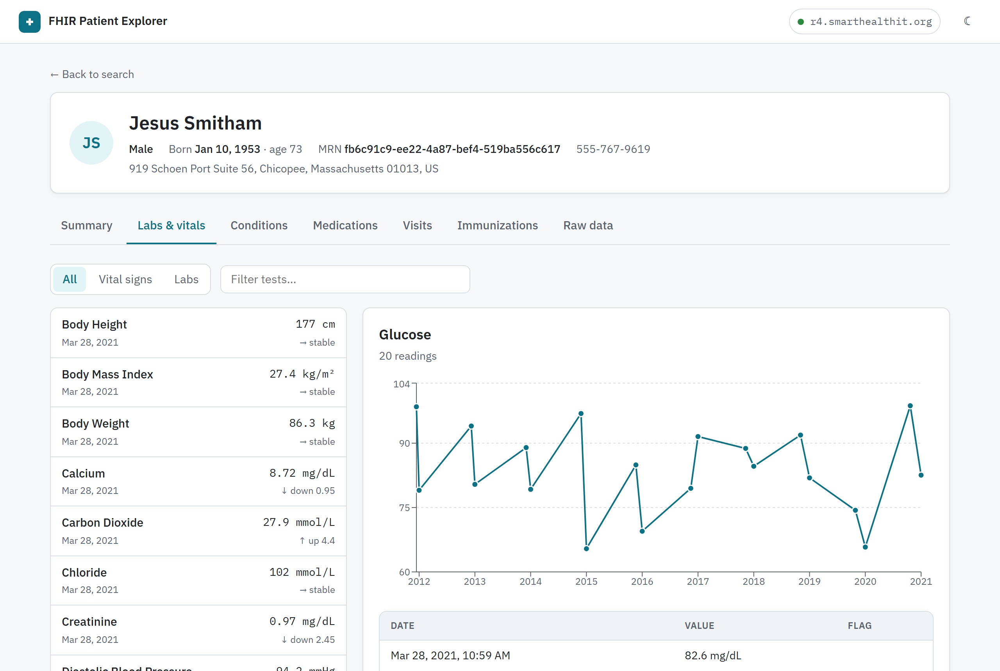
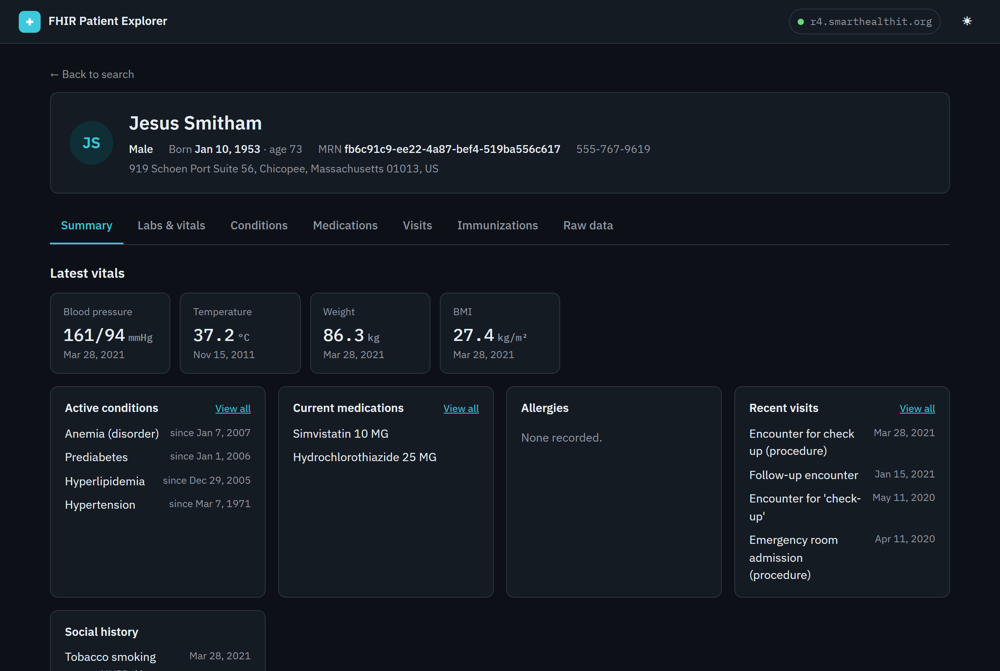

# FHIR Patient Explorer

Point it at a FHIR R4 server and read a patient's record the way a clinician would: a summary first, then labs with trends, problems, medications, visits and immunizations. The raw FHIR resources are always one tab away.

**Live:** https://fhir-patient-explorer-khaki.vercel.app (connected to the SMART Health IT sandbox, which holds synthetic patients only)



## Try it

1. Open the live site and search for `smith`.
2. Open **Jesus Smitham**. The summary shows his latest vitals, active problems and current medications.
3. Go to **Labs & vitals** and pick a test to see every reading on a chart and in a table.
4. **Raw data** shows each resource exactly as the server sent it, and lets you download the whole record as a FHIR Bundle.
5. Click the server name in the header to switch to the HAPI public server, or to your own.



## What each tab shows

| Tab | FHIR resources | What it adds on top of the raw data |
|---|---|---|
| Summary | Observation, Condition, MedicationRequest, AllergyIntolerance, Encounter | Latest vitals by LOINC code (systolic and diastolic combined into one blood pressure), active problems, current medications, smoking status |
| Labs & vitals | Observation | Groups readings by test and splits blood-pressure panels into their components. Flags results with the server's interpretation code, or against the reference range. Shows a trend from the last two readings |
| Conditions | Condition | Active and past problems, with refuted and entered-in-error entries hidden |
| Medications | MedicationRequest | Current prescriptions with instructions and reasons; repeat prescriptions of the same drug shown as one line |
| Visits | Encounter, Procedure | One timeline grouped by year, with emergency and inpatient stays marked |
| Immunizations | Immunization | Vaccines, newest first |
| Raw data | All of the above | Highlighted JSON per resource type and a downloadable `collection` Bundle |

Synthetic data has quirks, and the explorer handles a few of them. Synthea appends digits to names ("Jesus365"), which are stripped for display. Smoking status is filed under the `survey` category rather than `social-history`, so it's matched by its LOINC code instead.

## Working with real FHIR servers

FHIR is a standard, but servers differ, so most of the work went into handling those differences safely:

- **Paging.** Search results arrive in pages linked from `Bundle.link`. The explorer follows `next` links up to a limit, and shows a note when a record is larger than what it loaded. It asks for 250 results per page; servers cap this themselves.
- **Safe links.** A paging link is never followed to a different host, even if the server returns one.
- **Readable errors.** When a request fails, the explorer shows the server's own `OperationOutcome` message, such as "Resource Patient/x is not known", rather than just an HTTP code. Network and CORS failures get their own explanation, since they are the most common reason a server won't load in a browser.
- **Partial dates.** FHIR allows `1953` or `1953-01` as dates. They are shown at the precision given, and a plain date is never shifted across time zones.
- **Checking before switching.** A new server is only used after its CapabilityStatement loads. The server page then lists its FHIR version, its software, its patient search parameters, and any resource types the explorer needs that it doesn't list.

## Privacy

There is no backend. The browser talks directly to the FHIR server you choose, and the only things kept in the browser are your server choice, theme and last search. The public servers it ships with hold synthetic data only. Don't point a public deployment at a server with real patient data.

## Stack

- **App:** React 19, TypeScript and Vite, with React Router (nested routes, one per tab) and TanStack Query for fetching, caching and paging
- **Charts:** Recharts
- **Styling:** CSS Modules with design tokens, light and dark themes
- **FHIR types:** `@types/fhir` (R4)
- **Tests:** Vitest, Testing Library and MSW for component tests; Playwright and axe for browser and accessibility tests

## Tests

```bash
npm install
npm test            # 48 unit and component tests
npm run test:e2e    # 18 browser tests: 9 scenarios on desktop and mobile
```

- **Unit tests** cover the FHIR logic: paging, error handling, name, date and unit formatting, observation grouping and flagging, problem and medication lists, the visit timeline and Bundle export.
- **Component tests** render real pages against a mock FHIR server built with MSW.
- **Browser tests** use real responses recorded from the SMART sandbox (`npm run fixtures`), so they run offline. They walk through search, every tab of a record, lab charts and the Bundle download. They also run an axe accessibility scan on each main page, on both desktop and mobile.

The axe scans have already caught two real bugs: summary cards had no accessible names, and the logo link lost its name on small screens.

CI runs everything on each push. A weekly job re-records the fixtures from the live sandbox and warns if its data has drifted from what the tests expect.

## Run locally

```bash
npm install
npm run dev
```

## Project layout

```
src/fhir/        FHIR client and pure clinical logic, framework-free and unit tested
src/data/        Server selection and TanStack Query hooks
src/pages/       Search, server and patient pages (one file per tab)
src/components/  Layout, tables, JSON viewer, loading and error states
e2e/             Playwright tests and recorded fixtures
scripts/         Fixture recorder
```

## License

[MIT](LICENSE)
